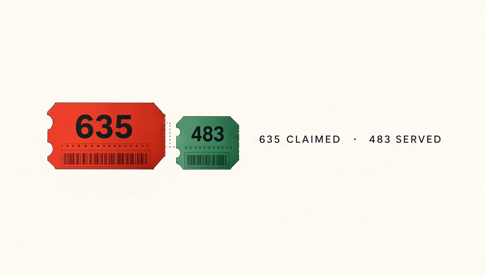
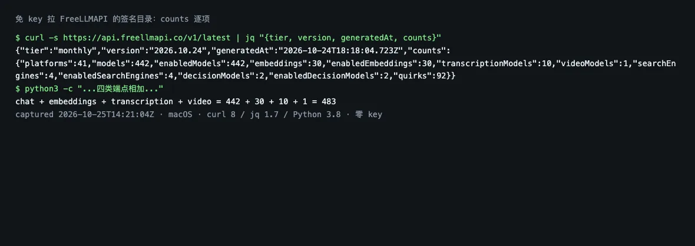
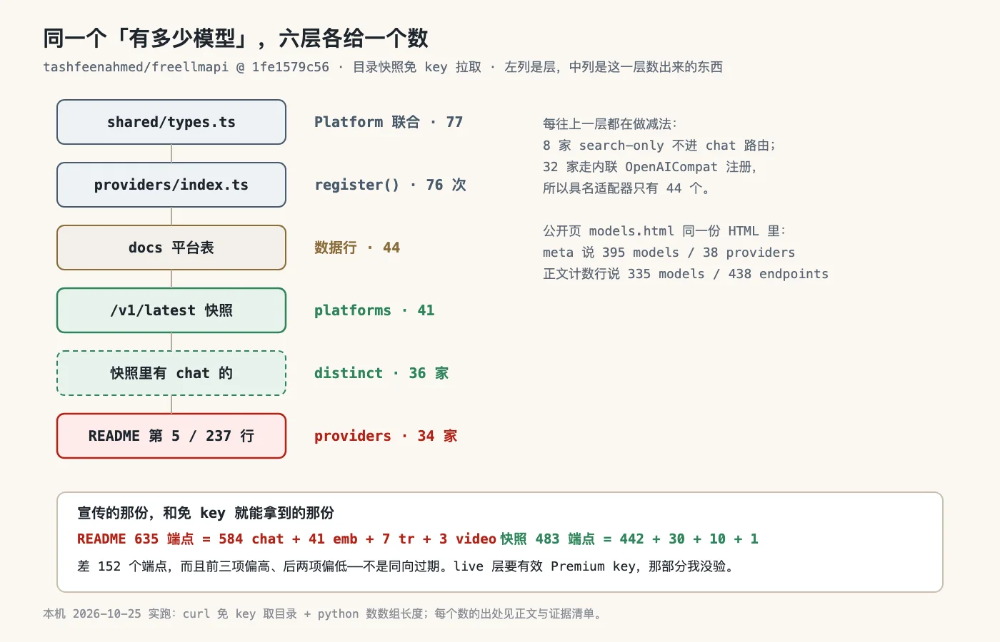
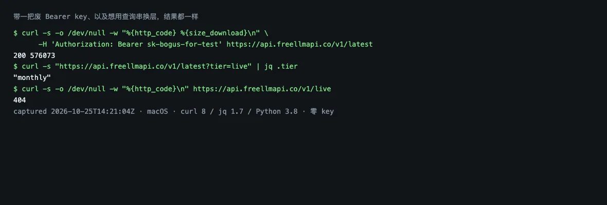

# FreeLLMAPI 说 635 个免费端点：我免 key 拿到的那份是 483



> 一句话结论：它宣传的免费端点数，和免 key 就能拉到的那份目录不是同一个东西，差 152 个。
> 现在该做什么：装之前先把那份签名目录拉下来数 `.counts`，别拿 README 的数当容量。

## 免 key 拉一次就知道是 483

先跑一条命令。`tashfeenahmed/freellmapi` 这个把几十家免费额度收进一个 OpenAI 兼容 `/v1` 的自托管网关，模型目录是一份签名 JSON，网关启动时自己去拉。拉它不要 key：

```text
$ curl -s https://api.freellmapi.co/v1/latest | jq '.counts'
{ "platforms": 41, "models": 442, "embeddings": 30,
  "transcriptionModels": 10, "videoModels": 1, "searchEngines": 4 }
```

442 行 chat、30 个 embedding、10 个转写、1 个视频，四类合计 483。快照的 `version` 是 2026.10.24，`generatedAt` 落在我抓它的前一天。



## 635 加得平，逐项却对不上 483

483 是拉出来的，635 是读来的。同一个 README 里两处给了它。

第 5 行是这么开的：`7.4 billion tokens per month. 34 free LLM providers. 635 free model endpoints.` 第 237 行再给分解：584 chat、41 embeddings、7 transcription、3 video。

加起来正好 635。它自己的算术没毛病。

把 483 那份快照按项摊开对：

| 项            | README | 快照 |
| ------------- | -----: | ---: |
| chat          |    584 |  442 |
| embeddings    |     41 |   30 |
| transcription |      7 |   10 |
| video         |      3 |    1 |
| 合计          |    635 |  483 |

方向不一致这点值得停一下。前三项 README 偏高，转写和视频反而偏低。如果是缓存过期，五项应该同向。所以更像是两份东西量的不是同一层。

## 四处四个数：34、38、41、76

483 与 635 之间，我还撞到另外两个数。

| 出处                | provider 数 | 模型 / 端点数       |
| ------------------- | ----------: | ------------------- |
| README 头部         |          34 | 474 族 / 635 端点   |
| models.html 的 meta |          38 | 395 模型            |
| models.html 正文    |        未标 | 335 模型 / 438 端点 |
| 签名目录快照        |          41 | 442 行 / 483 端点   |
| 源码 `register()`   |          76 | 不数模型            |

公开页那份更妙：同一份 HTML，meta description 写着 395 models across 38 providers，往下滚的计数行写着 335 of 335 models · 438 free endpoints。它跟自己也没对齐。

差这么多，代码里给了路径。`shared/types.ts` 的 `Platform` 联合有 77 个成员，`providers/index.ts` 里 `register()` 调了 76 次——其中 32 家不是具名适配器，是 `new OpenAICompatProvider({ platform: ... })` 内联注册的。我一开始数 import 语句，只数出 44，差点把 44 当成源码侧的真数。文档表 `docs/en/providers/01-supported-platforms.md` 也是 44 行，`google`、`groq`、`nvidia`、`mistral` 都在里面，但联合类型里那 33 个没有文档行的名字（`aclide`、`plugsky`、`router9` 这类）同样在跑。



一层层往上都在做减法：类型 77、注册 76、文档表 44、快照 41、真有 chat 行的 36、README 的 34。减法本身站得住，`search-only.ts` 那 8 家只出不进 chat 路由，注释写得清清楚楚。问题是这些数最后都被叫作 providers。

## 一把废 key 也返回 200

483 与 635 之间那层是什么，我用假 key 试了三次。

```text
$ curl -s -o /dev/null -w '%{http_code} %{size_download}\n' \
    -H 'Authorization: Bearer sk-bogus-for-test' \
    https://api.freellmapi.co/v1/latest
200 576073
$ curl -s 'https://api.freellmapi.co/v1/latest?tier=live' | jq '.tier'
monthly
```

字节数和匿名那次一模一样。没信号。



`catalog-sync.ts` 的注释解释了为什么：`A valid Premium license key (Bearer) gets the live tier`。换层靠的是有效 key，不是查询串。

这条对付费的人是实用信息：如果你以为自己的 key 生效了，这个端点不会给你任何反馈——不 401、不降级提示，只安静地返回免费那份。要确认，只能比对返回体里的 `version` 与 `counts`。

## 635 住在库里，不在 git 里

上周我写 `thesysdev/openui`，也是拿 README 的数字开刀。差别就在这：openui 把 benchmark 的样本和脚本都提交了，我抓下来重跑就能对账。FreeLLMAPI 的 635 住在运行时数据库里，`server/src/scripts/export-catalog.ts` 的注释写着这份产物从 live 库导出，源码树里没有一份静态文件能数出 635。

所以这不是数字造假那种便宜结论。它是另一件事：目录型产品的宣传数，可复算性取决于作者有没有把那份 JSON 留在仓库里。留了，读者能自己数；没留，读者只能信，或者像我一样去 curl 一个公开端点。

给同样在挑网关的人一条判别：先看仓库里有没有 catalog 的静态产物，再看公开端点免不免 key。两个都满足，README 那个数才有意义。

顺便给个规模参照：这个仓库 5 天发了 6 个补丁版本（v0.16.4 到 v0.16.9），10 月 24 日一天合了 8 个 fix 类 PR，npm 上那个 CLI 包上周被下载 6,049 次。项目不是没人管，是数字管不住数字。

## 盯 README 第 237 行有没有 tier

三条，各带触发条件。

- 如果第 237 行补上 live 与 monthly 两份各给一个数，主峰作废。判据：那一行出现 tier 限定词。
- 如果 `export-catalog.ts` 开始往仓库里落一份月度 JSON，我就能离线复算，不用 curl。
- 如果 models.html 的 meta 与正文计数对上（现在差 60 个模型），说明那页是生成的。

没验到的那一半也写清楚：付费 live 层我没 key、没验，所以本文不说 635 是错的，只说免 key 拿到的是 483。本地起 server 数 `/v1/models` 我没做，`server/package.json` 十二个依赖里没有数据库驱动，怀疑走 Node 22 内置的 sqlite，建库加迁移这轮时间不够。

项目地址：[https://github.com/tashfeenahmed/freellmapi](https://github.com/tashfeenahmed/freellmapi)
