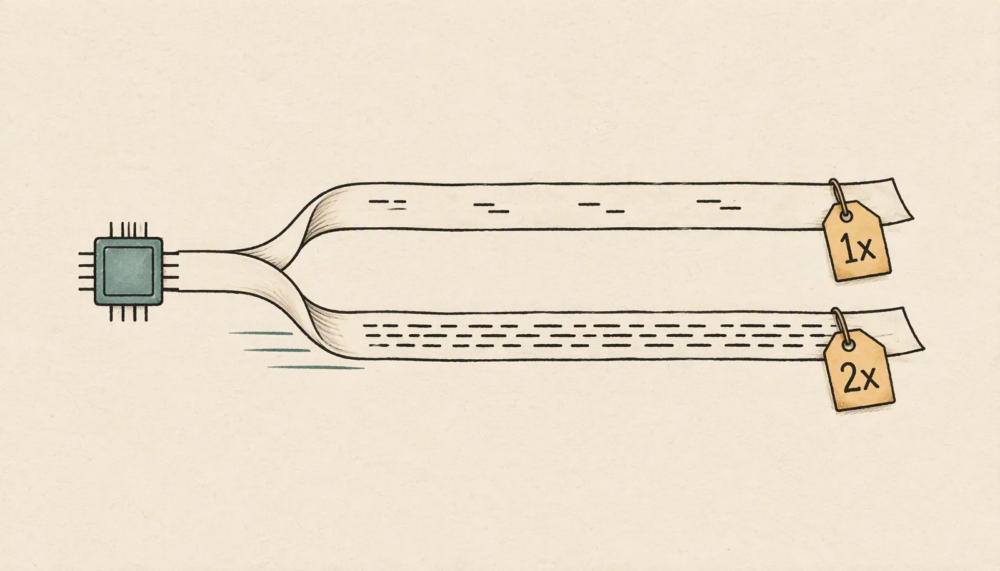
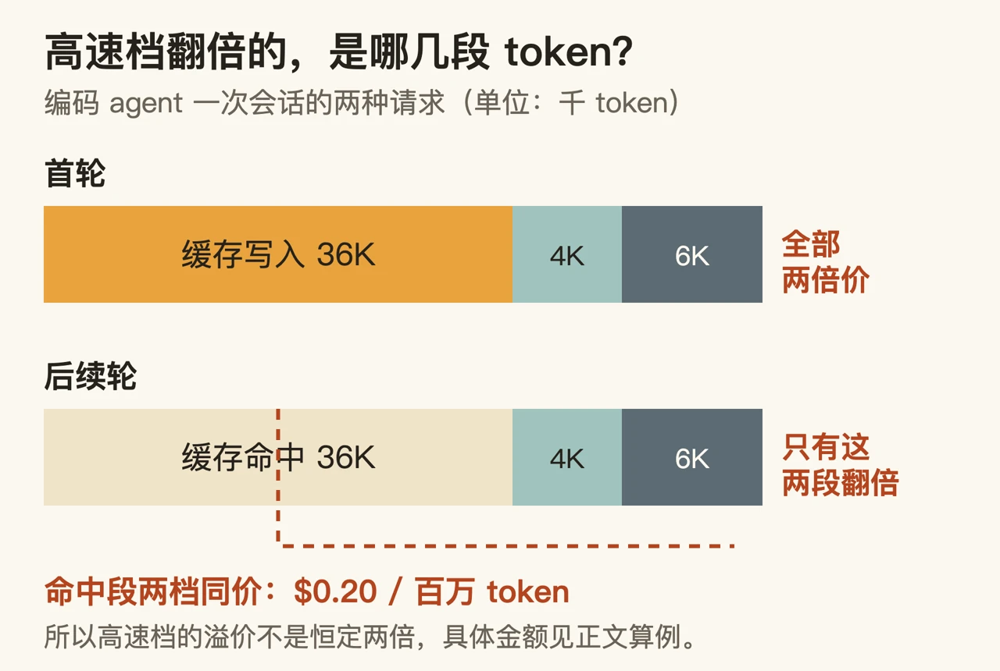

给产品接一个会写长答案的模型，最疼的往往不是它答得对不对，而是两件事：一个字一个字往外吐的时候用户在不在等，以及月底那张按 token 算出来的账单。

10 月 24 日凌晨（北京时间），月之暗面发布 **Kimi K3.1 Pro**，同时给出一个高速档 **K3.1 Pro Highspeed**。官方的说法是两者智能相同，高速档输出速度约 2~3 倍；价格是常规输入、输出、缓存写入全部翻倍，但缓存命中价一分没涨。

这篇讲三件会被“更强了、降价了”盖过去的事：两档的差价实际长什么样；单价降了三成为什么独立评测算出的每任务成本几乎没降；以及“11 月 4 日前开放权重”这句话里，哪部分还没到手。

先说清我的取材边界，后面的判断才好称重：**我没有跑通任何真实调用。** Kimi 开放平台的快速开始文档写明要先充值（最低 10 元）才解锁调用，本轮不擅自消费，所以文中所有金额都是按公开费率的推演，第三方读数都注明出处。

## 现在能调什么，还要等什么

技术博客是英文的，介绍第一款模型的原话是 “We’re introducing Kimi K3.1 Pro, the first model in our new K3.1 series and our most capable 3T-class open-weight model to date, with a 1-million-token context window”，紧接着 “We are also releasing Kimi K3.1 Pro Highspeed, which delivers 2-3× the speed of K3.1 Pro”。（译文：K3.1 系列的第一个模型，迄今最强的 3T 级开放权重模型，支持 100 万 token 上下文；同时放出 Highspeed，速度是标准版的 2~3 倍。）

同一篇里还有一句更关键的说明：K3.1 Pro 是 **Kimi K3 的后训练版本**，用了多得多的后训练算力。也就是说，这不是一次新的预训练，而是在已经开源的 K3（国内平台模型页标为“全球首个开源的 3 万亿级模型，2.8 万亿参数”）之上，用更大规模的强化学习再推一层。Artificial Analysis 给它的规格读数是 2.8T 总参数、104B 激活参数——官方口径只到“3 万亿级”，精确数字目前只有第三方给出。

把“已到手 / 还没到手”摊开：

- **已经能用**：Kimi 网页版与移动端、Kimi Work、Kimi Code，以及 API 上的 `kimi-k3.1-pro` 和 `kimi-k3.1-pro-highspeed`。API 兼容 OpenAI 格式，国内端点是 `https://api.moonshot.cn/v1`，两款模型的上下文上限都写作 1,048,576 token。官方定价页还提到 API 客户可选 Zero Data Retention，即按约定不保留请求数据。
- **企业环境**：需要管理员主动开启，发布时默认关闭。如果你的公司准备接入，先去后台确认开关，不要假设别的组织已经打开。
- **还没到手**：完整权重。原文两处写“将于 11 月 4 日前发布”，这是路线图书诺，不是今天的交付物；许可证条款没有出现在我读过的任何一份官方材料里。

“全球最大开源模型上新”这类标题把两件事压成了一件事：今天上新的是模型和它的付费入口，开源那半边还压着一个日期。

## 两档的差价，落在哪一类 token 上

对打算接 API 的人来说，这次最能马上用上的部分是计费规则，因为官方把公式写明了。一行输入 token 只会属于下面四类之一，各按自己的费率计，最后加上输出：

- 未缓存的常规输入，按输入费率；
- 命中已有缓存的前缀，按缓存命中费率；
- 第一次写进缓存的前缀，按缓存写入费率，分 5 分钟和 1 小时两种 TTL（缓存存活时间，过期就要重新写入）；
- 输出 token，按输出费率，**包含模型思考用的 token**。

两档的费率表（每百万 token，美元，税前，官方定价页核对日期标注为 2026-10-24）：

| | 常规输入 | 缓存命中 | 5 分钟写入 | 1 小时写入 | 输出 |
|---|---|---|---|---|---|
| `kimi-k3.1-pro` | $2.00 | $0.20 | $2.00 | $4.00 | $10.00 |
| `kimi-k3.1-pro-highspeed` | $4.00 | **$0.20** | $4.00 | $8.00 | $20.00 |

官方中文定价页对这一点的解释比表格直白：“Highspeed 的常规输入、输出和缓存写入标价均为标准版的两倍。其缓存输入费率仍为每百万 token $0.20，与标准模型相同。因此，包含大量缓存上下文的请求需要单独计算成本，不能简单地将标准模型账单翻倍。”

国内开放平台首页给的是人民币一套：标准档输入 ¥13.00、输出 ¥68.00、缓存写入 ¥13.00、命中 ¥1.30；高速档 ¥26.00 / ¥136.00 / ¥26.00，命中同样是 ¥1.30；上一代 K3 是 ¥20.00 / ¥100.00 / ¥20.00 / ¥2.00。倍数关系和美元那套一致。

“贵一倍”是个会被负载形态改写的说法，值得自己算一遍。下面四个场景全部是**按上表费率的推演，不是实测账单**，输入结构假设写在表里：

| 场景 | 输入结构 | 输出 token | 标准档 | 高速档 | 实际溢价 |
|---|---|---|---|---|---|
| A 编码 agent 首轮 | 4K 新输入 + 36K 缓存写入（5 分钟档） | 6K | $0.1400 | $0.2800 | 2.00× |
| B 同一会话后续轮 | 36K 命中 + 4K 新输入 | 6K | $0.0752 | $0.1432 | 1.90× |
| C 长文档问答 | 100K 命中 + 2K 新输入 | 500 | $0.0290 | $0.0380 | 1.31× |
| D 重输出任务 | 8K 命中 + 8K 新输入 | 24K | $0.2576 | $0.5136 | 1.99× |

规律是：**溢价跟着输出占比走。** 输出是整倍差价里最大的一项，所以任务越像“写很多字”，高速档越接近两倍价；反过来，把长前缀缓存好、只让它回几百个 token，溢价能被压到 1.3 倍附近。极端情况下——所有 token 都命中缓存、没有输出计费——两档价会完全相同，只是那种请求本身不存在。首轮是另一头：缓存写入按 5 分钟档也和常规输入同价（$2.00 / $4.00），所以首轮是干净的两倍。

把 Claude 两档放进来对照更直观。标价出自 Anthropic 定价页（我 2026-10-25 查阅，不是下面 Artificial Analysis 那张表的换算）：Claude Sonnet 5.5 输入 $2 / 输出 $10 / 缓存读 $0.10，Claude Opus 5.5 输入 $4 / 输出 $20 / 缓存读 $0.20。对得上的是：**标准档 K3.1 Pro 的账单结构贴着 Sonnet 5.5，高速档的账单结构则和 Opus 5.5 重合**——场景 B 里高速档和 Opus 5.5 都是 $0.1432，场景 D 里都是 $0.5136。买高速档花的钱，在 Claude 那边对应的是旗舰档价目。

## 单价降了三分之一，每个任务的账却没怎么变

厂商给的三项单价都比上一代低：K3 是 $3.00 输入、$15.00 输出、$0.30 缓存命中，K3.1 Pro 统一低三分之一。但 Artificial Analysis 在 10 月 23 日的发布评测里写的是“每个任务的成本与 K3 大致相同，约 $1.98”，并给出一个原因：K3.1 Pro 每个智能指数任务用掉 55K 输出 token，比 K3 的 48K 多 14%。

这里我要指出一个算不平的地方，因为它比“降价”两个字更值得注意。只看输出那一侧：单价乘以 0.67，用量乘以 1.14，输出成本应该低四分之一左右。要让整个任务的账单“大致相同”，持平只能发生在输入和缓存那一侧，而 Artificial Analysis 没有拆开讲，也没给 K3 的每任务读数。到 10 月 25 日我查它的 leaderboard 时，同一个“每任务成本”显示为 **$2.11**——和 $1.98 是两个不同时间、不同加权口径的读数，不该当成同一个数用。

结论不是“这次没降价”，而是：**每任务成本是个需要你自己按业务量测的东西，公告的单价和评测站的每任务成本都不能直接替你算。** 模型这边能推动账单的两个因素都写在官方规则里：它是个话痨——在整个智能指数评测里生成了 150M 输出 token，所有模型中位数是 87M，被 Artificial Analysis 标为“极其冗长”（这一单项它排 92/116，即 116 个模型里第 92 名，越靠后越冗长）；而且思考关不掉，只能调 `reasoning_effort`（low / high / max，默认 max）。所以真要省钱，第一个该动的旋钮是 effort 和任务拆分，而不是等下一版降价。

## 第 4 名的智能，141 名的出字速度

厂商的 benchmark 表很长，我挑三个跟决策有关的，然后立刻换成第三方口径，因为两套数并不完全对得上。

官方自测：Terminal-Bench 4.0 得 65.7%，同一行注明 GPT-6 Astra 58.2%、Claude Opus 5.5 66.4%；内部长程编程基准 Kimi Code Bench 3.0 Long-horizon 从 K3 的 55.95% 提到 61.2%；BenchCAD 带工具 92.7%（Opus 5.5 为 96.2%）。还有一个内部基准 Kimi Hallu Bench Hard，claim-level 幻觉率从 K3 的 23.4% 降到 8.3%——官方紧跟了一句免责：该评测是事实准确性的压力测试，所报告的比率不代表日常使用中的整体错误率。

Artificial Analysis 在 10 月 23 日的发布评测里，同一个 Terminal-Bench 4.0 给出 67%（它自己的 harness，并称这一项是全场最高），而 K3 在这一项只有 13%。**同一个基准名字，两套数字，跑法不同**：官方那张表里至少一部分对手的分数，是直接取自 OpenAI、Anthropic、z.ai 的公布页。所以我读公告分数时会先确认是谁跑的、用什么环境跑的。

同一家 leaderboard 把几个决定性维度放在一张表里（我 2026-10-25 的整表读数；这几行的上下文窗口都是 1M，所以省掉那一列）：

| 模型 | 智能指数 | 每任务成本 | 中位 tok/s | 首块延迟 | 总响应 |
|---|---|---|---|---|---|
| Claude Opus 5.5（max） | 58 | $5.98 | 96 | 652.61s | 657.81s |
| Claude Sonnet 5.5（max） | 56 | $5.46 | 134 | 371.62s | 375.34s |
| Claude Opus 5.5（xhigh） | 56 | $3.46 | 82 | 109.62s | 115.71s |
| **Kimi K3.1 Pro** | **55** | **$2.11** | **58** | **3.07s** | **46.53s** |
| GPT-6 Astra（max） | 53 | $3.26 | 66 | 278.25s | 285.78s |
| Gemini 4 Argon（high） | 53 | $1.99 | 81 | 57.01s | 63.20s |
| GLM-5.3（max） | 45 | $2.01 | 98 | 2.39s | 27.86s |

这张表要先读三件事，否则会歪。各家是按不同推理强度拆成多行的，K3.1 Pro 这一行是它的推理档（该站模型页写明这是 reasoning 版本）；“每任务成本”是它按自己那套智能指数任务加权算出来的钱，跟你业务的 token 结构无关；“中位 tok/s”是输出流速度，和“首块延迟”“总响应”是三个不同的东西——表里那行 K3.1 Pro 的 58，与它模型页上的 57.5 是同一次测量的两种舍入。

在这三个维度上，K3.1 Pro 的位置很别扭也很好用：**智能 55，这张表里排第四；每任务成本 $2.11，是智能 55 分及以上那几行里最低的（$1.99 的 Gemini 4 Argon 智能低两分，属于下一档）；中位输出速度 58 tok/s，在它的模型页上排 141/186，被标为“明显偏慢”。** 首块延迟 3.07 秒，是这张表里 53 分以上模型最低的一个——Anthropic 那两个 max 行的首块要等上几分钟；唯一比它更快的首块来自 45 分的 GLM-5.3（2.39 秒）。

这组数恰好解释了高速档存在的理由，也解释了它的边界。把“快”拆成三个可买的量：

- **什么时候开始出字**（首块延迟）：3.07 秒，这一档标准档就做到了，高速档解决不了更多。
- **字出得多快**（tok/s）：58 tok/s 是短板。按这个数推，一个 6,000 token 的回答要打 104 秒；如果官方 2~3 倍成立，高速档落在 35~52 秒。这是我把厂商声称拿来做除法，**不是实测**——Artificial Analysis 的高速档页面此刻还是 404。
- **整件事多久结束**（总响应）：表里那个 46.53 秒是 Artificial Analysis 在它自己的标准任务上测的完整耗时，和上面按 6,000 token 折算的 104 秒不是同一件事，只能用来判断量级，不能互相验算。

顺带给个参照：国内平台模型列表里，上一代编码模型的高速档 `kimi-k2.7-code-highspeed` 标的是“输出速度约 180 Tokens/s，短上下文场景可达 260 Token/s”。所以“速度档”不是这次的新实验，是把已有做法搬到了旗舰模型上。

## 为开放权重而削掉的能力，而且把代价量化了

这次发布里我认为最值得工程师细读的一段是安全部分，因为它罕见地写出了“削了什么、在哪两个阶段削、削完少了多少分”。

英文原话是这样：随着后训练规模变大，漏洞挖掘表现稳步上升；团队追踪来源，发现 cyber-related content 混在通用 mid-training 语料里，RL 环境组合里也有 cyber-related tasks；接着那句是关键——“For the open-weight release of K3.1 Pro, we identified and removed cyber-related data from both training stages, while retaining the general-purpose coding tasks needed for model usefulness.”（为开放权重这次发布，我们在两个训练阶段识别并移除了网络攻击相关数据，同时保留模型有用性所需的一般编程任务。）

然后他们给了一个可核算的对照：在内部基准 xdev-bench-hard（专家构造、基于真实源码的漏洞发现与利用任务，多数复现 Linux 内核、Node.js、JavaScriptCore、Exim、VirGL 等近期披露的漏洞并开启缓解措施）上，没有做这些削减的检查点 pass@3（每个任务允许 3 次尝试）解出 90.5%，最终的 K3.1 Pro 是 81.0%。官方还补了一句：K3.1 Pro 的网络攻击能力仍落后于已公开至少三个月的前沿专有模型。

我的读法，这部分是判断不是官方结论：削减是做在这个模型本身上的，评测对象就叫“final K3.1 Pro”，而动机写在“开放权重原则”那一节里。所以**今天你在 API 里调到的这个版本，应该已经是削过的**，而不是“API 满血、权重打折”。官方也没有把两者描述成能力不同的两个制品。实际含义有两层：一是准备用模型做防御性代码审计的人，别指望它顶替专门的漏洞挖掘工具；二是“为了将来能开放权重，现在就把能力压住”是一种新的产品约束形式——它让你今天用的模型和 11 月 4 日那批权重服从同一套限制。

讨论区对这个取舍反应两极。那条 1,067 分、665 条评论的 Hacker News 帖子里，有人说希望不受限的网络能力扩散得慢一点、世界需要准备；也有人反驳说现在被削的只会让政府受益，防御方同样需要强模型；还有人直接抱怨给普通用户的版本在网络安全上被削弱了，跟美国模型一样。这些只是社区观察，不构成能力证据，但它们说明这个决定被相当多人当作影响自己的事在读。

至于 11 月 4 日那批权重本身，现在还判断不了：许可证条款、权重体积与分片、量化和部署支持都没给。关于上一代 K3 用什么许可，我只找到二手记载（有页面写“Modified MIT”，有页面写“Kimi K3 License”），在 Hugging Face 上没能取到一手页面，所以我不把 K3 的许可结论写进本文的事实里。

## 现在值得做什么，还要等什么

**已经在一个模型上跑生产的团队。** 把这次发布当“档位变化”评估，而不是“版本升级”。按顺序做三件事：

1. 拿你自己真实的输入/输出比例套上表算两档差价，看它落在 1.3 倍还是 2 倍。决定成本形态的是“这个任务花多少钱在写字上”。
2. 把 `reasoning_effort` 从默认 max 往低调一档，用同一批任务比一次账单和答对率——输出 token 是这个模型账单的主要变量。
3. 重新检查缓存前缀的设计。官方明确说，措辞相似并不保证命中：前缀靠前的部分一旦改动，它后面的内容就不再被复用。命中率和缓存写入次数是你能改的部分，单价不是。

**独立开发者，主要在意响应体感。** 高智能模型的首块延迟普遍难看的时期（Anthropic 的 max 行是几百秒级），K3.1 Pro 的 3.07 秒很有吸引力；但“很快开始出字、然后慢慢打印”对交互式产品是另一种难受。我的建议是先别为了流式体验直接上高速档 API：高速档的速度只有厂商声称，没有独立读数。可以先用会员产品感受——官方定价页写 Pro、Max、Ultra 三档都在网页版、Kimi Work 和 Kimi Code 里包含 K3.1 Pro Highspeed，而 API 是按量单独计费，两条花钱路径不互相抵扣。顺带一提，100 万 token 的超长对话容量只给到 Max 和 Ultra，Plus 档没有。

**写安全相关工具的人。** 先接受“它是被削过的”这个前提，再决定用不用。真要评估就照官方口径自己跑一批样本，别把 xdev-bench-hard 的 81.0% 当成你的通过率。

**还在用 K2 系列的人。** 平台文档另有两个日期：K2 系列 2026 年 10 月 31 日起停止向新注册用户开放，计划在 12 月底下线全部 K2 系列模型。这和这次发布无关，但和迁移排期有关。

**还要等的**：11 月 4 日前权重的实际放出与许可证文本；高速档的第三方速度实测；以及官方“逐步提高开放权重里的网络能力”这句话会不会变成有日期的东西——原文用的是 “we intend to”，那是意图。

## 判断：速度成了可买的档位，账单成了用量问题

前两节已经把数字摊开了，这一节只说我的位置和它的代价。

这次 K3.1 Pro 真正改变的东西比它的排名更具体：**它把输出速度变成了一个可以单独购买的价格档，同时把每个任务的账单从“单价问题”变成了“用量问题”。** 前者对做交互式产品的人是好事——以前只能在“聪明”和“快”之间挑一家，现在可以在同一家里挑档位；后者对做预算的人是坏事——你需要自己测，公告里的“降价三分之一”基本没有预算意义。

这个档位划分也有它不好的一面：把速度切成两档，意味着同一套 prompt 现在要多维护一条路由、两套预算口径和一个“什么时候切档”的判断逻辑。Anthropic 用 fast mode（同样的 2 倍价、官方称 2.5 倍速）走的是同一条路，所以这不是月之暗面一家的怪做法，而是这个行业正在把“快”从模型属性变成商品规格。我的判断是：接下来一年，选型的第一个问题可能不再是“用哪家”，而是“这个请求值不值得让它跑快点”。

至于那 3 分。Artificial Analysis 说权重放出后，开放权重最强与专有前沿之间的智能指数差距会从 12 分缩到 3 分（它 10 月 23 日的口径，当时开放权重最强是 46 分的 MiMo-V2.6-Pro，专有最强是 58 分的 Opus 5.5 max）。这个说法有个容易被跳过去的前提：缩到 3 分的那个模型，是为了能够开放而削过网络攻击能力的同一个模型。所以“开源追上前沿”这句话，条件不在分数上，在你想用它做哪件事上。只是写代码、做研究、跑智能体流程，11 月 4 日之后你会多一个便宜选择；如果你的场景包含漏洞挖掘与利用，那 3 分之间的距离可能比表上看起来更长。

参考与来源（均于 2026-10-25 查阅）：

- Kimi 官方技术博客：[kimi.ai/blog/kimi-k3-1-pro](https://www.kimi.ai/blog/kimi-k3-1-pro)
- Kimi 开放平台模型列表：[platform.kimi.com/docs/models](https://platform.kimi.com/docs/models)
- Kimi 快速开始（端点与充值门槛）：[platform.kimi.com/docs/guide/kimi-k3-1-pro-quickstart](https://platform.kimi.com/docs/guide/kimi-k3-1-pro-quickstart)
- Kimi K3.1 Pro 定价页（页面自标费率核对日期 2026-10-24）：[kimi.ai/zh-hans/resources/kimi-k3-1-pro-pricing](https://www.kimi.ai/zh-hans/resources/kimi-k3-1-pro-pricing)
- Artificial Analysis 发布评测（2026-10-23）：[artificialanalysis.ai/articles/kimi-k3-1-pro-launch-benchmarks](https://artificialanalysis.ai/articles/kimi-k3-1-pro-launch-benchmarks)
- Artificial Analysis 模型页与 leaderboard：[模型页](https://artificialanalysis.ai/models/kimi-k3-1-pro)、[leaderboard](https://artificialanalysis.ai/leaderboards/models)
- Anthropic 定价页（单价对照）：[anthropic.com/pricing](https://www.anthropic.com/pricing)
- Hacker News 讨论串（1,067 分 / 665 评论，仅作社区观察）：[news.ycombinator.com/item?id=50212065](https://news.ycombinator.com/item?id=50212065)
