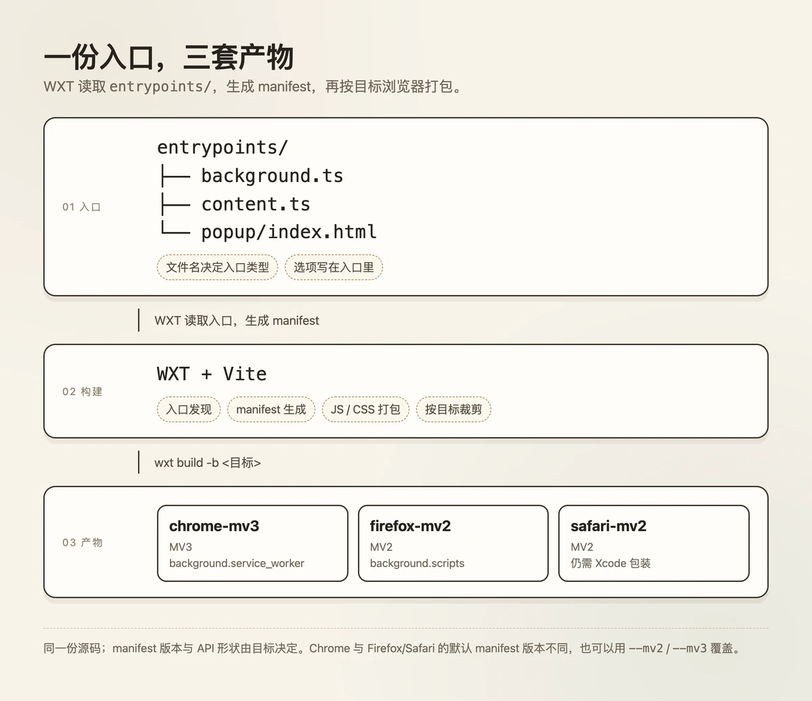
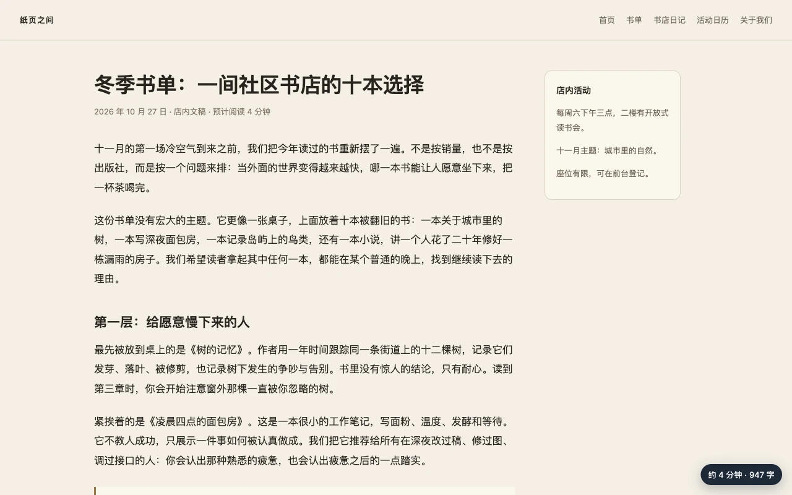
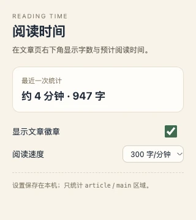

给内容站加一个“阅读时间”提示，页面里的代码可能不到一百行。把它做成浏览器扩展，麻烦才刚开始：manifest 里要声明 content script 的匹配范围、popup 的入口、background 的脚本；Chrome 侧是 MV3，WXT 给 Firefox 的默认产物还是 MV2；改一行样式，得去扩展管理页手动刷新；等你想同时发两个商店，又要把同一套逻辑复制成两份构建配置。

WXT 想接住的就是这一层。它是 `wxt-dev` 维护的 MIT 开源框架，2023 年开始，最新版 0.21.5 发布于 2026-10-26。官方把它比作“扩展界的 Nuxt”：底层仍是 Vite，但用文件路径决定入口，再由入口生成 manifest。你继续写普通前端代码，扩展的样板交给它。

这篇文章用一个能跑的“阅读时间”扩展，把 WXT 的入口、内容脚本 UI、storage 同步和跨浏览器构建串一遍；最后给出它和 extension.js、CRXJS、手写 Vite 方案的选择建议。实测只覆盖 Chrome 的加载与交互，Firefox、Safari 的边界会单独说明。

## 它先替你收走了 manifest 和入口约定

WXT 的核心不是一套新的扩展 API，而是一套构建约定。浏览器扩展的 API 仍然是 `browser.*` / `chrome.*`；WXT 负责把文件找出来、生成 manifest、打包，并在 dev 时把改动送进浏览器。它不替你做界面设计和权限决策，也不负责商店审核；这些仍然是产品层面的事。

一个最小项目长这样：

```text
reading-time/
├── entrypoints/
│   ├── background.ts
│   ├── content.ts
│   └── popup/
│       └── index.html
├── utils/settings.ts
├── assets/content.css
└── wxt.config.ts
```

文件名决定入口类型。`content.ts` 会成为 content script，`popup/index.html` 成为点击图标打开的弹窗，`background.ts` 在 Chrome MV3 里是 service worker，在 Firefox MV2 里是 background scripts。入口需要的 manifest 选项就近写在入口文件里：

```ts
export default defineContentScript({
  matches: ['http://127.0.0.1/*'],
  // ...
});
```

这里故意只匹配 `127.0.0.1`；如果你用 `localhost` 或自己的域名，记得改这一行。端口不进 match pattern，但 host 会。这行 `matches` 会自动进入生成的 manifest，不需要再维护一份独立的 `manifest.json`。popup 的标题、图标、默认弹窗也可以在 HTML 的 `<meta>` 里配置；`wxt.config.ts` 则放全局的权限、名称、描述。入口和 manifest 在同一个地方，改动不容易两处漂移。

除了入口发现，WXT 还自带几件常用工具：内容脚本的 Shadow DOM UI、带默认值和迁移能力的 storage 封装、i18n 与 analytics 模块，以及一个可以把构建产物打包成 ZIP、再提交到 Chrome/Edge/Firefox 商店的 `wxt submit`。这些能力不一定每个扩展都用得上，但它们决定了你不需要在每个新扩展里重写一遍同样的胶水。



代价是约定。入口必须放在 `entrypoints/` 下，而且只支持零层或一层深度；把 `popup.ts`、`popup.css` 和 `popup.html` 平铺在入口目录里，会被当成三个入口。这个限制不难适应，但你得先知道它存在。

## 用一个阅读时间扩展走通全流程

目标很小：打开一篇文章时，右下角显示“约 X 分钟 · Y 字”；点扩展图标，可以关闭徽章、调整阅读速度。设置要在 popup 和页面之间共享，但不需要后端。

“字”在这里是一个近似单位：中文按汉字计数，英文和数字按连续串计数，标点不计。徽章上写的“字”就是这套近似算法的单位。只统计 `article` 元素；如果没有 `article`，退回 `main`，再退回 `body`。这样在有 `article` 的页面上，导航、侧栏和页脚不会把阅读时间撑大。

### 初始化与依赖

WXT 要求 Node 22 以上。本文用的是 Node 24.22.0，初始化命令：

```bash
npx wxt@latest init reading-time --template vanilla --pm npm
cd reading-time
npm install
npm run dev
```

`npm install` 会触发 `wxt prepare`，根据入口生成类型。实际测试时我在一个隔离目录里加了 `--no-git`，避免脚手架初始化一个新的 git 仓库；后面的构建和加载都基于这个目录。

### 内容脚本：计数、徽章、同步

先定义共享的 storage 项：

```ts
import { storage } from '#imports';

export const readingSpeed = storage.defineItem<number>('local:readingSpeed', {
  fallback: 300,
});

export const showBadge = storage.defineItem<boolean>('local:showBadge', {
  fallback: true,
});

export interface ReadingStats {
  units: number;
  minutes: number;
  title: string;
  at: number;
}

export const lastStats = storage.defineItem<ReadingStats | null>(
  'local:lastStats',
  { fallback: null },
);
```

`storage.defineItem` 把 key、类型和默认值放在一起；`fallback` 让第一次读取就有值，不需要自己判断 `undefined`。key 必须带 `local:`、`session:`、`sync:` 或 `managed:` 前缀，这是 WXT 对浏览器 storage API 的一层约束。这份 demo 用的是 `local:`，只在本机浏览器内共享，不做跨设备同步。

内容脚本负责统计和渲染：

```ts
import '@/assets/content.css';
import { lastStats, readingSpeed, showBadge } from '@/utils/settings';

function countArticleText() {
  const root =
    document.querySelector('article') ??
    document.querySelector('main') ??
    document.body;
  const text = root.innerText ?? '';
  const cjk = (text.match(/[\u4e00-\u9fff]/g) ?? []).length;
  const words = (
    text.replace(/[\u4e00-\u9fff]/g, ' ').match(/[A-Za-z0-9]+/g) ?? []
  ).length;
  return cjk + words;
}

export default defineContentScript({
  matches: ['http://127.0.0.1/*'],
  cssInjectionMode: 'ui',
  async main(ctx) {
    const ui = await createShadowRootUi(ctx, {
      name: 'reading-time-badge',
      position: 'overlay',
      alignment: 'bottom-right',
      anchor: 'body',
      onMount(container) {
        const badge = document.createElement('div');
        badge.className = 'badge';
        container.append(badge);

        const render = async () => {
          const enabled = await showBadge.getValue();
          if (!enabled) {
            badge.style.display = 'none';
            return;
          }
          badge.style.display = 'inline-flex';

          const speed = await readingSpeed.getValue();
          const units = countArticleText();
          const minutes = Math.max(1, Math.ceil(units / speed));
          badge.textContent = `约 ${minutes} 分钟 · ${units.toLocaleString('zh-CN')} 字`;

          await lastStats.setValue({
            units,
            minutes,
            title: document.title,
            at: Date.now(),
          });
        };

        void render();
        ctx.setTimeout(() => void render(), 800);

        const unwatchShow = showBadge.watch(() => void render());
        const unwatchSpeed = readingSpeed.watch(() => void render());
        ctx.onInvalidated(() => {
          unwatchShow();
          unwatchSpeed();
        });
      },
    });

    ui.mount();
  },
});
```

这里有三个 WXT 的便利点：

- `defineContentScript`、`createShadowRootUi`、`storage` 都是自动导入的，不需要手写 import；`npm run compile` 能通过，说明类型生成正常。想显式导入也可以，从 `#imports` 取。
- `cssInjectionMode: 'ui'` 配合 `createShadowRootUi`，徽章和样式都挂在 Shadow DOM 里。页面的全局 CSS 不会污染徽章，徽章也不会反过来影响页面。
- `ctx.setTimeout` 和 `ctx.onInvalidated` 绑定这次内容脚本的生命周期。扩展被禁用或更新时，定时器和 `storage.watch` 会一起清掉；不清理时，这类回调容易在扩展上下文失效后继续跑。

一个和入口约定有关的构建细节：`content.css` 不能直接放在 `entrypoints/` 根目录，否则 WXT 会把它识别成名为 `content` 的第二个入口，报“Multiple entrypoints with the same name”。把它放到 `assets/` 再 `import` 进来，构建就正常了。

popup 只做两件事：读同一份 storage，改同一份 storage。下面是 `popup/main.ts` 的核心片段，省略了 DOM 查询和 `renderStats` 的定义：

```ts
showInput.checked = await showBadge.getValue();
speedInput.value = String(await readingSpeed.getValue());

showInput.addEventListener('change', () => {
  void showBadge.setValue(showInput.checked);
});
speedInput.addEventListener('change', () => {
  const speed = Number(speedInput.value);
  if (Number.isFinite(speed) && speed > 0) {
    void readingSpeed.setValue(speed);
  }
});
lastStats.watch(() => void renderStats());
```

内容脚本写入 `lastStats`，popup 通过 `lastStats.watch` 更新“最近一次统计”；popup 改 `readingSpeed`，内容脚本通过 `readingSpeed.watch` 重新计算。两个上下文没有直接互相调用，只共享 storage。popup 的 HTML 只需两个控件（`#show`、`#speed`）和一个 `#stats` 文本节点；`wxt.config.ts` 给 `manifest.permissions` 加 `storage`；background 只在安装时设置 action title；`assets/content.css` 负责徽章的定位与配色。这些是常规扩展代码，没有逐行展开。

### 构建与实测结果

```bash
npm run build          # chrome-mv3
npm run build:firefox  # firefox-mv2
npm run zip            # 生成可上传的 zip
```

Chrome 构建产物在 `.output/chrome-mv3`。实际生成的 manifest 里，`permissions` 只有 `storage`；host 访问只来自 content script 的 `matches`，范围是 `http://127.0.0.1/*`，没有声明额外的 `host_permissions` 或网络权限。这是有意收窄的：真实扩展应该只匹配自己的站点，而不是 `<all_urls>`。

我用 Playwright 以解包方式把 `.output/chrome-mv3` 加载进 Chrome for Testing 156.0.8078.47，测试页是一篇本地虚构的书店文章。普通版 Chrome 从 137 起不再接受 `--load-extension`（[Chrome 扩展新闻](https://developer.chrome.com/blog/extension-news-june-2025)），所以没有用日常浏览器；这不影响扩展本身的构建，但做自动化验收时要准备 Chrome for Testing 或 Chromium。



| 检查项 | 实测结果 |
|---|---|
| 文章区域统计 | 947 个单位；徽章数字与页面内同一算法的复算一致（等价性检查，不是独立人工计数）；导航与侧栏未计入 |
| 默认 300 字/分钟 | 约 4 分钟 |
| 改成 200 字/分钟 | 约 5 分钟，弹窗与页面一起更新 |
| 关闭徽章 | 立即隐藏；重新打开后恢复 |
| 页面注入同名 `.badge` 样式（背景红、字号 40px，均带 `!important`） | 徽章仍是深灰底、13px 字，Shadow DOM 隔离生效 |
| 非匹配 host（localhost） | 页面正常打开，徽章数量为 0 |

947 这一项是用同一套统计函数在页面里复算的，验证的是徽章与函数一致，不是人工逐个数字符。



这些数字只说明这个 demo 在本地虚构页面上按预期工作，不代表真实站点的性能或稳定性。demo 在页面加载后 800 毫秒补算一次，没有监听 SPA 路由变化，也没有用 `MutationObserver` 持续跟踪 DOM；如果文章是异步渲染的，或者站点是单页应用，还需要在 `main` 里加上路由监听或节流后的 DOM 观察。

## 同一份代码，三套 manifest

同一个项目继续跑：

```bash
npm run build:firefox
npx wxt build -b safari
```

会得到 `.output/firefox-mv2` 和 `.output/safari-mv2`。同一个项目除了 Chrome 和 Firefox，还能再生成 Safari 目标。WXT 默认给 Chrome 生成 MV3，给 Firefox 和 Safari 生成 MV2；也可以用 `--mv2` / `--mv3` 覆盖。Chrome 产物（节选）：

```json
{
  "manifest_version": 3,
  "permissions": ["storage"],
  "background": { "service_worker": "background.js" },
  "action": { "default_popup": "popup.html" },
  "content_scripts": [
    { "matches": ["http://127.0.0.1/*"], "js": ["content-scripts/content.js"] }
  ]
}
```

Firefox 产物（节选）：

```json
{
  "manifest_version": 2,
  "permissions": ["storage"],
  "background": { "scripts": ["background.js"] },
  "browser_action": { "default_popup": "popup.html" },
  "content_scripts": [
    { "matches": ["http://127.0.0.1/*"], "js": ["content-scripts/content.js"] }
  ]
}
```

不是把一份 manifest 复制三份，而是按目标改结构：MV3 的 background 是 `service_worker`，MV2 是 `scripts`；MV3 的 `action` 在 MV2 里叫 `browser_action`；`web_accessible_resources` 的形态也不同。WXT 还提供了 `import.meta.env.BROWSER` 与 `import.meta.env.MANIFEST_VERSION`，可以在代码里按目标分支。

`npm run zip` 会把 Chrome 产物打成 `.output/reading-time-0.0.0-chrome.zip`，这次是 25.93 kB、13 个文件。ZIP 不是“发布”本身，但省掉了手动挑文件、排除源码和映射的步骤。

边界也要说清：

- **Firefox 只做了构建验证，没有运行。** 本机没有安装 Firefox；WXT 的构建日志还提示，新扩展从 2025-11-03 起需要 `data_collection_permissions`，MV3 还需要扩展 ID。真要在 Firefox 上发布，这些商店要求要单独处理。
- **Safari 也只做了构建验证。** WXT 能生成 `safari-mv2`，但 Safari 扩展还需要 Xcode 的原生包装与签名，WXT 文档明确说不自动完成发布。
- **dev 模式的 HMR 没有实测。** 官方文档把 HMR 和快速重载列为主要卖点，但这次只验证了生产构建和真实加载；如果你最在意的是 dev 体验，建议先在自己的项目里跑一遍 `wxt dev`。
- **复杂的 SPA 与跨域 iframe 没有覆盖。** demo 是一个静态文章页，不涉及路由切换、动态 DOM、iframe 注入。

## 和 extension.js、CRXJS、手写方案怎么选

把问题限定在“我要做一个浏览器扩展，前端栈是 Vite/TypeScript”，可以这样比较：

| 方案 | 定位与适合场景 |
|---|---|
| [WXT](https://github.com/wxt-dev/wxt) | 框架 + Vite；生成 Chrome、Firefox、Safari 目标；文件入口、自动 manifest、内置 storage/UI。适合想用约定减少样板的前端团队。 |
| [extension.js](https://github.com/extension-js/extension.js) | 零配置框架；支持 Chrome、Edge、Firefox、Safari；CLI + 托管浏览器二进制。适合想一条命令跑起来、少碰构建配置的人。 |
| [CRXJS](https://github.com/crxjs/chrome-extension-tools) | Vite 插件；面向 Chromium（MV3）；在现有 Vite 配置上加插件。适合已有 Vite 应用、只想加扩展入口的人。 |
| 手写 Vite + MV3 | 自建；自己写 manifest 和构建脚本，平台取决于实现。适合构建链特殊、需要完全控制的人。 |

本轮验证情况：WXT 在 Chrome for Testing 156 里加载并测试；Firefox 和 Safari 只构建、没运行；extension.js 和 CRXJS 没有运行。表格里的能力来自各自 README 和 npm 元数据。

WXT 的取舍是约定换样板，extension.js 是零配置换控制权，CRXJS 是插件换更小的接入面：它不是完整框架，入口约定和 storage 封装不像 WXT 那样属于框架能力。extension.js 的 npm 最新版是 4.1.35（2026-10-22），CRXJS 是 3.0.0（2026-09-24），两者都在更新。

如果你正在看旧教程，[Plasmo](https://www.npmjs.com/package/plasmo) 值得先确认一下时间：它的 npm 最新版 0.90.5 发布于 2025-05-17。这个事实本身不等于项目不能用，但意味着新项目要自己承担后续 Vite 和浏览器 API 的兼容风险。

## 现在该不该用

WXT 现在仍是 0.x。0.21.5 发布于 2026-10-26，升级前应该看官方的 [Upgrading 文档](https://wxt.dev/guide/resources/upgrading.html)；它不是那种“装上去三年不用管”的稳定层。把它放进项目之前，至少要接受两点：入口要遵守 `entrypoints/` 的约定；扩展的构建输出和 manifest 由框架生成，遇到特殊需求时要确认能不能在 `wxt.config.ts` 或 hook 里表达。

demo 本身只做到最小验证：统计逻辑只认 `article`/`main`，并且只在加载后补算一次。真实项目里，内容脚本要考虑异步内容、路由切换、页面隐藏时的清理，以及更细的权限范围。WXT 提供的是生命周期工具和构建约定，不会替你决定这些产品行为。

我的建议分三种情况：

- 你已经在维护一个跨 Chrome/Firefox 的扩展，入口不止一个，每次改 manifest 都要对照文档：WXT 值得用一个下午做一次迁移试验，先量一下入口发现、跨浏览器构建和 storage 封装到底省了多少。
- 你只是给现有 Vite 应用加一个小 popup，路由和权限都简单：CRXJS 或手写 Vite 插件更轻，不必为了一个入口引入整套框架。
- 你想要零配置、托管浏览器二进制、少碰构建链：extension.js 值得对比；它的路线和 WXT 不完全相同，最好用同一个最小扩展各做一遍。

WXT 的价值不是让扩展开发变得神奇，而是把重复的构建工作收进一个可读的约定。先用最小扩展把入口、manifest、内容脚本 UI 和 storage 跑通，再决定要不要把主扩展交给它。

项目地址：[wxt-dev/wxt](https://github.com/wxt-dev/wxt)；文档：[wxt.dev](https://wxt.dev/guide/installation.html)。
