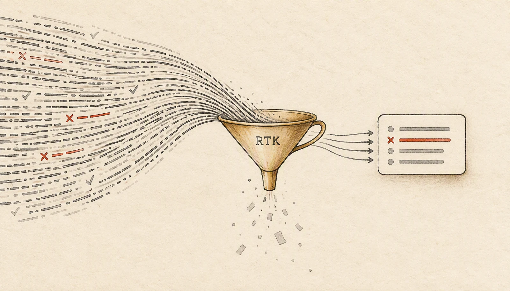

让 AI 编程助手修一个失败的测试，它通常会先跑 `git status`、`npm test`，再翻日志。每一步的原始输出都会进上下文。一个 34 条用例的 `node:test` 运行约 4.4KB，一份 120 条订单的 JSON 有 17.8KB，一段 168 行的日志有 13.7KB。模型真正需要的，往往只是三个失败用例名和一行超时错误。

RTK 就卡在这条链路上。它是一个用 Rust 写的单二进制 CLI 代理，README 里列了 100 多条命令，支持 Claude Code、Codex、Cursor 等 18 个 AI 编程工具。它把它认识的 Bash 命令改写成 `rtk` 版本，按命令类型过滤、分组、截断、去重，再把压缩后的结果交给 agent。最新版本是 2026 年 10 月 25 日发布的 1.1.0。

但省下的 token 和 agent 还能不能修好测试，不是同一个数。我在一个隔离的虚构项目里量了 8 条命令，下面把压缩率和信息损失放在一起看。

## 它卡在 shell 和 agent 之间

RTK 不是模型，也不是代码索引。它不理解业务逻辑，只根据命令类型决定怎么处理输出。README 把策略分成四类：过滤噪声、把同类结果分组、截断过长的上下文、合并重复日志。`git status` 去掉提示语，只留分支和文件状态；`git diff` 去掉部分上下文，保留改动；`cat` 变成 `rtk read`；`log` 只留错误和警告；测试输出只留失败项。

这个位置决定了它能省哪一块。agent 自带的长输出处理通常按长度截断，不知道哪一行是失败用例。手动过滤要求每条命令都写成 `git status --short`、`rg --max-count`、`jq` 的形式，脚本能维护，但 agent 不一定按你的写法执行。RTK 的假设是：命令类型本身包含了“该留什么”的信息。

RTK 不回答代码在哪，它只处理命令输出。代码检索是另一层工具，后面再比。

## 接进 agent 之前，先看清 hook 管到哪

本文实测的是 OSS 版，许可证为 Apache-2.0。完整版多一个 BUSL-1.1 的压缩 engine；`rtk-proxy` 是另一个 BUSL-1.1 的守护进程，不在这次测试范围内。安装可以走 release 包，也可以用 README 里的 brew、winget 或安装脚本。

```bash
# macOS x86_64，v1.1.0 的 OSS 包；Apple Silicon 换 aarch64
gh release download v1.1.0 -R rtk-ai/rtk \
  -p 'rtk-oss-x86_64-apple-darwin.tar.gz'
tar xzf rtk-oss-x86_64-apple-darwin.tar.gz
./rtk --version   # rtk 1.1.0
```

让 hook 生效靠 `rtk init`。我用隔离的 HOME 跑过 `rtk init -g --dry-run`：它会创建 `~/.claude/RTK.md`，往 `CLAUDE.md` 里加引用，并询问是否把 `PreToolUse`、匹配 `Bash` 的 hook 写进 `settings.json`。非交互模式下它默认不写这个文件。安装二进制和让 hook 生效是两步，别把 `rtk --version` 能跑当成 agent 已经在用。

hook 的覆盖范围比名字看起来窄。它只处理 Bash 工具调用，agent 内建的 `Read`、`Grep`、`Glob` 不经过它。命令改写也不全：`rtk rewrite "npm test"` 返回退出码 1，等于没有改写；`npm run test` 才会被改成 `rtk npm run test`；`cat file` 会被改成 `rtk read file`，但不带压缩参数。装了 hook 不等于所有输出都会变小，具体能省哪一块，要看你常用的命令有没有被覆盖。

本文只测 CLI 层，没有把 hook 写进本机的 Claude Code 配置。文中出现的 `rtk` 命令，就是 hook 生效后 agent 会看到的那一层输出；hook 改写规则通过 `rtk rewrite` 和 dry-run 观察。

## 8 条命令的实测：从 0 到 99%

演示项目是虚构的：28 个 JavaScript 源文件，34 条 `node:test` 用例（3 条失败），25 条 Vitest 用例（3 条失败），一份 120 条订单的 JSON，一段 168 行的应用日志。测试环境是 macOS 13.1、Intel x86_64、Node 24.22.0、RTK OSS 1.1.0、Vitest 5.0.5。token 数用 GPT-4o 分词器（o200k_base）计算，不是 RTK 面板里的 `bytes / 4` 估算。

下表只对比字节和 token，信息是否够用放在后面的小节里。第一列是 RTK 命令；`read`、`log`、`json` 的原始命令是 `cat`，`vitest` 那行的原始命令是 `npx vitest run`，其余行的原始命令就是去掉 `rtk` 的版本。

| RTK 命令 | 原始 → RTK（字节 / token） |
|---|---:|
| `rtk git status` | 522 / 147 → 154 / 51（-65.3%） |
| `rtk git diff` | 1,965 / 642 → 1,463 / 463（-27.9%） |
| `rtk read --max-lines 20` | 1,741 / 487 → 486 / 129（-73.5%） |
| `rtk log` | 13,716 / 4,984 → 604 / 238（-95.2%） |
| `rtk json` | 17,857 / 6,049 → 159 / 55（-99.1%） |
| `rtk npm test` | 4,447 / 1,377 → 4,400 / 1,361（-1.2%） |
| `rtk vitest run` | 2,681 / 1,065 → 236 / 83（-92.2%*） |
| `rtk grep` | 187 / 62 → 187 / 62（0%） |

`*` Vitest 这一行的 -92.2% 是把测试输出换成 passthrough 消息后的字节差，不算有效压缩，下面单独说。`grep` 那组只有三条匹配，压缩前后完全一样；小结果集不是它的战场。

### git status 和 git diff：压掉提示，留下名字

这两条最接近“装了就能用”。原始 `git status` 会把“On branch”“Changes not staged for commit”和提示语都带进来；RTK 只留一行分支和 `M`、`??` 状态，文件数不多时，agent 仍能知道改了哪些文件。`git diff` 去掉了 `index` 行和部分上下文，但每个文件的改动、hunk 头和新增删除统计都还在。

代价是少了改动的完整上下文。对人来说，几行上下文有助于判断改动位置；对 agent 来说，只要 hunk 头在，通常还能定位。遇到跨文件重命名或大段移动时，仍需看原始 diff。

### read、log、json：压得狠，但只剩摘要

`rtk read` 的默认行为仍是全文。同一个 1.7KB 文件，不加参数时输出 1,741 字节；加上 `--max-lines 20` 后变成 486 字节。留下的内容是这样（节选）：

```js
const TAX_RATE = 0.09;

export function total(items) {
}
[57 more lines]
```

这适合让 agent 先摸清文件结构，不适合让它据此修改业务逻辑。函数名和签名还在，后面的函数体没了，agent 只能再读一次全文。`rtk log` 也一样：它把 168 行日志压成错误清单和计数，8 条超时错误都在，160 条 info 被折叠。排错时很有用，追踪某个请求的完整路径时就不够。

`rtk json` 的压缩率最高，但它给出的是预览，不是 JSON。键没有引号，数组只留一个样例，尾部是 `... +119 more`。把它交给 `jq` 会直接失败。这个输出适合让 agent 知道“有哪些字段、第一条长什么样”，不适合做数据计算。

### 测试输出：三种结果，最需要逐条验收

测试是 agent 最需要精确信息的场景，也是这次测试里最不稳定的一块。直接跑 `rtk npm test`，34 条用例的输出几乎原样保留，只省了 1.2%。换成通用过滤器 `rtk test npm test`，输出变成最后 5 行加一个 recall 号：

```text
OUTPUT (last 5 lines):
      actual: 12,
      expected: 13,
      operator: 'strictEqual',
      diff: 'simple'
    }
[full output: rtk recall <hash>]
```

这时 4,447 字节的原始输出只剩 162 字节，但三个失败用例名都没了。`rtk recall <hash> --full` 能把 4,446 字节的原输出取回来，代价是 agent 再花一次调用。省下的 token 在 recall 时又还了回去，除非 agent 只需要知道“测试挂了”，不需要知道哪三条。

Vitest 这条更直接。用 `rtk vitest run` 跑 Vitest 5.0.5，agent 收到的是：

```text
JSON report written to <...>/.vitest/json/output.json
[RTK:PASSTHROUGH] vitest parser: All parsing tiers failed
```

原始 2,681 字节的测试输出没有出现，失败用例名也没有。RTK 把 JSON 报告写到了磁盘，agent 只看到路径，得自己决定去读。相比之下，`rtk npx vitest run` 会原样传递 2,661 字节的输出，没有压缩，至少信息还在。

## 压得越狠，越要检查剩下的是什么

RTK 自带 `rtk gain` 面板。把上面 8 条命令在干净 HOME 里各跑一次，面板显示 8 条命令，输入 10.2K token，输出 1.9K token，节省 8.3K，节省率 81.2%。其中 `json` 99.1%、`log` 95.6%、`read` 72.0%、`git status` 70.2%、`git diff` 25.6%、`npm test` 1.1%、`grep` 0%。Vitest 那一条也被记成 43.0% 节省。

这里有两个口径要分开看。第一，面板用的是 `bytes / 4` 估算，不是真实分词器；我把 8 条命令的原始输出用 GPT-4o 分词器相加，得到 14,813 token，压缩后 2,442 token，整体节省 83.5%。方向一致，绝对值不同，单条命令的差距在几个百分点。第二，面板算的是“输出字节变少了多少”，不是“agent 还能不能完成任务”。Vitest 那条只回了两行 passthrough，实际测试信息全丢了，面板仍把它记成节省；`rtk gain -F` 这次也没有记录解析失败。

`rtk gain` 适合看趋势和发现哪类命令在贡献节省，不适合单独当正确性证明。要判断能不能用，得把 agent 实际看到的输出拿出来，和原始输出逐行比：失败用例名在不在、错误行在不在、JSON 还能不能解析、函数体是不是被清空。

## 和手动过滤、MCP 代码检索比，它该放在哪

| 做法 | 主要作用 / 代价 |
|---|---|
| 原样交给 agent | 靠上下文策略丢内容；不增加成本，先丢哪行不可控 |
| 手动过滤 | 你写规则，每条命令都要改；agent 不一定照做 |
| RTK | 按命令类型过滤；覆盖不全、有损，解析失败可能不显眼 |
| MCP 代码检索 | 建索引回答“代码在哪”；不压命令输出 |

接入成本也不同：RTK 要装二进制并接 hook，MCP 检索要起 server、建索引，手动过滤最轻，但每条命令都要写。RTK 的独特之处是“透明”和“按命令类型”。它不要求 agent 改工作流，也不要求你为每条命令写正则；只要命令被覆盖，输出就会变短。代价也同样明显：覆盖有限，过滤器有损，hook 只看到 Bash，内建 Read/Grep 不经过它。

MCP 代码检索工具解决另一层问题。像 code-review-graph 这类工具会把代码库建成可查询的图，让 agent 只在需要时读相关文件；RTK 则让 agent 读到的每条命令输出更短。两者组合是合理的：先用代码检索定位，再用 RTK 压 shell 输出。但如果你的 agent 主要靠内建 Read 和 Grep 工作，RTK 的收益会小很多，因为那些调用根本不进 hook。

## 该不该用：先让它在 git 和日志上证明自己

我的判断：RTK 值得试，但把它当“输出过滤器”，不要当“上下文管理器”。它的价值不在“最多省 90%”这个数字，而在“这条命令的输出里，哪些信息可以安全地丢”。如果是我用，git status 和 git diff 可以进日常，log 和 json 只在侦察时开，测试输出先验收再决定。

如果你的 agent 每天在 Bash 里跑大量 git、构建、日志和 JSON 预览命令，又愿意保留 `rtk recall` 和 `rtk bypass` 作为退路，可以先上。先别急着 `rtk init -g`，在一个仓库副本上跑 `rtk git status`、`rtk log`、`rtk git diff`，把输出和原始版本逐行比一遍，再用自己的分词器算一次 token。测试链路单独试：`rtk test npm test` 能不能 recall 回失败用例，`rtk vitest` 在你的 Vitest 版本上是否解析成功。都过了，再把 hook 接进日常。

反过来，如果 agent 主要用内建 Read/Grep/Glob，或者你必须把 JSON 原样交给下游程序、依赖完整函数体来改代码，RTK 要么帮不上，要么会把关键信息藏起来，装上去反而多一层排查成本。

许可证也影响采用方式。OSS 版是 Apache-2.0；完整版多出的 engine 是 BUSL-1.1，生产使用免费，但不能把 engine 或衍生物作为收费、托管服务转卖。团队要把 RTK 包进对外产品，先看清这一层，不要只看“开源”两个字。

RTK 的压缩率越高，越要检查它丢掉的是不是 agent 下一步要用的那一行。先让它在 git 和日志上跑通一遍，再决定要不要让它碰测试输出。

项目地址：[https://github.com/rtk-ai/rtk](https://github.com/rtk-ai/rtk)  
版本与许可证：[v1.1.0 release](https://github.com/rtk-ai/rtk/releases/tag/v1.1.0) · [README](https://github.com/rtk-ai/rtk#readme)
